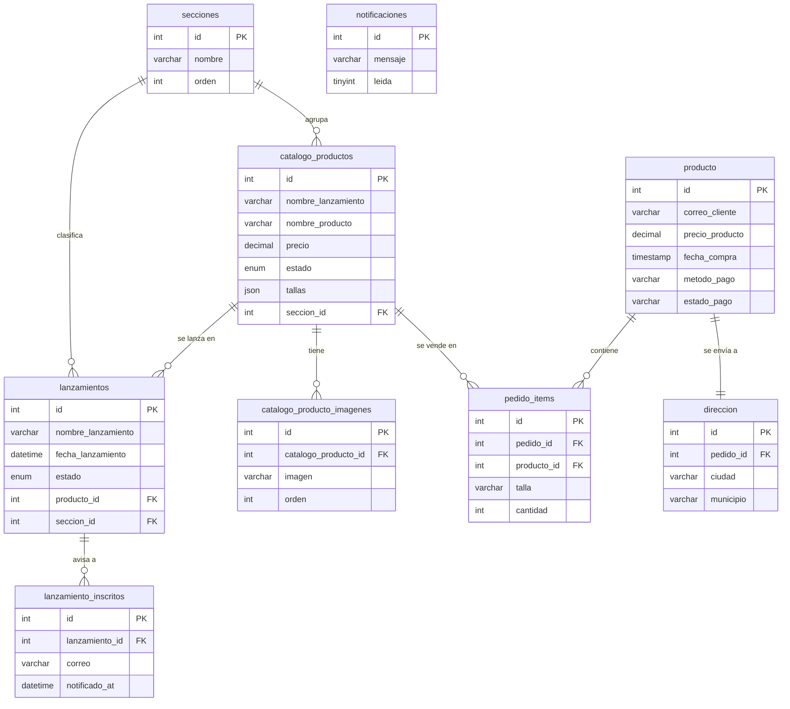

# Modelo entidad-relación

Base local `underlaw_mineria`. Es la estructura final de la base real de la tienda (`database.sql` más las migraciones del proyecto web), consolidada en `sql/01_esquema.sql`.

Se omiten solo las tablas de contenido del sitio (`sitio_ajustes`, `sitio_imagenes`, `sitio_videos`), que no aportan a la minería.

> **Ojo:** la tabla `producto` guarda los **pedidos** (compras de clientes). El catálogo de prendas está en `catalogo_productos`. Se respeta el nombre real para no romper la compatibilidad.



## Vista de minería `v_mineria_items`

Es la fuente de las tres predicciones: una fila por prenda vendida en pedidos **aprobados** (`estado_pago = 'APPROVED'`).

```
pedido_items ─┬─ producto (pedido) ── direccion
              └─ catalogo_productos ── secciones
```

Columnas:
- `item_id`, `pedido_id`, `fecha_compra`, `correo_cliente`, `metodo_pago`, `ciudad`;
- `producto_id`, `nombre_producto`, `nombre_lanzamiento`, `seccion`, `talla`, `cantidad`;
- `precio_unitario`, `subtotal`.

El cliente se identifica por `correo_cliente`, porque la base real no tiene una tabla de clientes.
